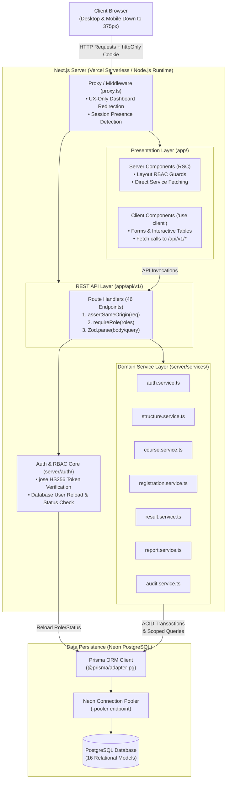
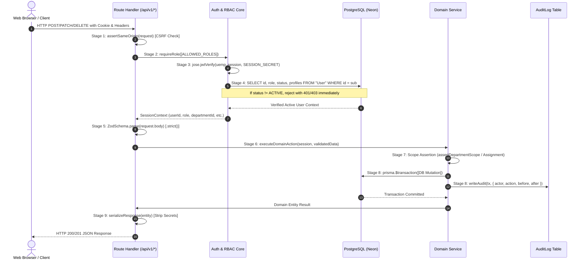
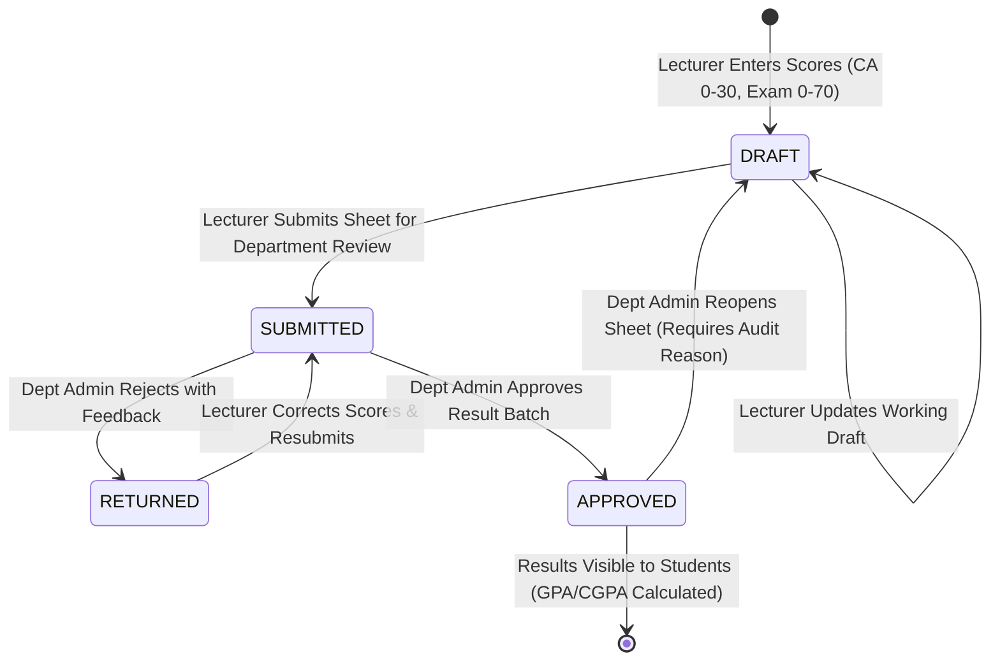

# System Architecture & Technical Specifications

This document outlines the software architecture, security model, data flow, permission matrix, and operational decisions governing the University Education Management Portal (UEMP).

---

## 1. System Overview

UEMP is engineered as a unified, full-stack Next.js application using the App Router. The system architecture coordinates serverless React Server Components (RSC), client-side interactivity, REST route handlers (`/api/v1/*`), domain service layers, Prisma ORM, and PostgreSQL hosted on Neon.



---

## 2. Authenticated Request Lifecycle

Every mutating API invocation follows a strict 9-stage execution pipeline before committing changes to PostgreSQL:



---

## 3. Authentication & Session Architecture

1. **Password Hashing**: Passwords are encrypted using `bcryptjs` with salt rounds = 10. Passwords are never stored in plaintext, logged, or returned in serialized responses.
2. **Stateless JWT Tokens**:
   - Built using `jose` with `HS256` symmetric signing.
   - The payload contains **only** `{ sub: userId }`. No permissions, department scopes, or roles are baked into the token.
   - Expiration is strictly enforced at **8 hours**.
3. **Session Cookie Security**:
   - Named `uemp_session`.
   - Flags: `httpOnly: true`, `SameSite=Lax`, `path: "/"`, `Secure: true` in production environments.
   - Tokens are **never** accessible to client-side JavaScript or stored in `localStorage`.
4. **Database Verification on Every Request**:
   - Token signature validity alone is insufficient. On every invocation of `getSession()`, `requireAuth()`, or `requireRole()`, the user is reloaded from PostgreSQL.
   - If `user.status !== "ACTIVE"`, the request is immediately rejected with HTTP 401, revoking access in real time without waiting for token expiry.
5. **Brute-Force & Lockout Protection**:
   - Tracks `failedLoginCount` and `lockedUntil` on the `User` model.
   - After **5 consecutive failed attempts**, the account is locked for **15 minutes** (HTTP 423 Locked).
   - Successful authentication resets `failedLoginCount` to 0.

---

## 4. Role-Based Access Control (RBAC) & Permission Matrix

Authorization is enforced at the server level via `requireRole(...)` and domain service functions. UI button visibility and `proxy.ts` redirects are purely user-experience conveniences and never substitute for server authorization.

### Complete API Permission Matrix (46 Endpoints)

| Endpoint | Method | Allowed Roles | Scope Enforcement / Description |
|---|---|---|---|
| `/api/health` | `GET` | Public | System status and database connectivity check. |
| `/api/v1/auth/login` | `POST` | Public | Authenticates credentials, sets session cookie. |
| `/api/v1/auth/logout` | `POST` | Public | Clears session cookie. |
| `/api/v1/auth/clear-session` | `GET` | Public | Clears session cookie and redirects to `/login`. |
| `/api/v1/auth/me` | `GET` | All Authenticated | Returns current authenticated user and profile. |
| `/api/v1/auth/password` | `PATCH` | All Authenticated | Changes user's own password with current password check. |
| `/api/v1/profile` | `GET, PATCH` | All Authenticated | Reads/updates own profile details. |
| `/api/v1/faculties` | `GET` | All Authenticated | Lists academic faculties. |
| `/api/v1/faculties` | `POST` | `SUPER_ADMIN` | Creates faculty. |
| `/api/v1/faculties/[id]` | `PATCH` | `SUPER_ADMIN` | Updates faculty metadata. |
| `/api/v1/departments` | `GET` | All Authenticated | Lists departments. |
| `/api/v1/departments` | `POST` | `SUPER_ADMIN` | Creates department. |
| `/api/v1/departments/[id]` | `PATCH` | `SUPER_ADMIN` | Updates department metadata. |
| `/api/v1/programs` | `GET` | All Authenticated | Lists programs (scoped for Dept Admin). |
| `/api/v1/programs` | `POST` | `SUPER_ADMIN, DEPARTMENT_ADMIN` | Creates degree program (Dept Admin scoped to own dept). |
| `/api/v1/programs/[id]` | `PATCH` | `SUPER_ADMIN, DEPARTMENT_ADMIN` | Updates degree program (Dept Admin scoped to own dept). |
| `/api/v1/levels` | `GET, POST` | `SUPER_ADMIN` | Manages academic levels (100L–500L). |
| `/api/v1/sessions` | `GET, POST` | `SUPER_ADMIN` | Manages academic sessions (e.g. 2026/2027). |
| `/api/v1/sessions/[id]` | `PATCH` | `SUPER_ADMIN` | Updates session or activates current session. |
| `/api/v1/semesters/[id]` | `PATCH` | `SUPER_ADMIN` | Toggles semester registration open/closed status. |
| `/api/v1/grade-scale` | `GET` | All Authenticated | Returns configured grading scale. |
| `/api/v1/grade-scale` | `PUT` | `SUPER_ADMIN` | Updates institutional grading scale. |
| `/api/v1/users` | `GET, POST` | `SUPER_ADMIN` | Lists users (paginated) / creates new user. |
| `/api/v1/users/[id]` | `PATCH` | `SUPER_ADMIN` | Updates user details. |
| `/api/v1/users/[id]/status` | `PATCH` | `SUPER_ADMIN` | Activates, suspends, or deactivates user accounts. |
| `/api/v1/users/[id]/role` | `PATCH` | `SUPER_ADMIN` | Changes user role (enforces Decision D6 conversion rules). |
| `/api/v1/users/[id]/password` | `PATCH` | `SUPER_ADMIN` | Administrative password reset. |
| `/api/v1/courses` | `GET` | `SUPER_ADMIN, DEPARTMENT_ADMIN, LECTURER` | Lists courses (scoped to department/assignments). |
| `/api/v1/courses` | `POST` | `SUPER_ADMIN, DEPARTMENT_ADMIN` | Creates course (Dept Admin scoped to own dept). |
| `/api/v1/courses/[id]` | `PATCH` | `SUPER_ADMIN, DEPARTMENT_ADMIN` | Updates course details (immutability guards). |
| `/api/v1/course-assignments` | `GET` | `SUPER_ADMIN, DEPARTMENT_ADMIN, LECTURER` | Lists assignments (scoped to department/lecturer). |
| `/api/v1/course-assignments` | `POST` | `SUPER_ADMIN, DEPARTMENT_ADMIN` | Assigns course to lecturer (Decision D12 single-lecturer). |
| `/api/v1/course-assignments/[id]`| `DELETE` | `SUPER_ADMIN, DEPARTMENT_ADMIN` | Unassigns course (blocked if results exist). |
| `/api/v1/students` | `GET, POST` | `SUPER_ADMIN, DEPARTMENT_ADMIN` | Lists students / provisions student profile. |
| `/api/v1/students/[id]` | `GET, PATCH` | `SUPER_ADMIN, DEPARTMENT_ADMIN` | Views / updates student profile (scoped). |
| `/api/v1/lecturers` | `GET, POST` | `SUPER_ADMIN, DEPARTMENT_ADMIN` | Lists lecturers / provisions lecturer profile. |
| `/api/v1/lecturers/[id]` | `GET, PATCH` | `SUPER_ADMIN, DEPARTMENT_ADMIN` | Views / updates lecturer profile (scoped). |
| `/api/v1/registrations` | `GET, POST` | `STUDENT, SUPER_ADMIN, DEPARTMENT_ADMIN`| Student registers courses; Admins view scoped registrations. |
| `/api/v1/registrations/[id]` | `DELETE` | `STUDENT` | Drops course registration (blocked if results exist). |
| `/api/v1/registrations/available`| `GET` | `STUDENT` | Returns eligible courses for active semester. |
| `/api/v1/results` | `GET` | `STUDENT` | Student views own approved results and CGPA. |
| `/api/v1/results/sheet` | `GET` | `LECTURER, DEPARTMENT_ADMIN, SUPER_ADMIN`| Loads score sheet for a course assignment. |
| `/api/v1/results/draft` | `POST` | `LECTURER` | Saves draft scores (0–30 CA, 0–70 Exam). |
| `/api/v1/results/submit` | `POST` | `LECTURER` | Submits score sheet for departmental approval. |
| `/api/v1/results/submissions` | `GET` | `SUPER_ADMIN, DEPARTMENT_ADMIN` | Lists pending result approval batches. |
| `/api/v1/results/approve` | `POST` | `SUPER_ADMIN, DEPARTMENT_ADMIN` | Approves submitted results batch (concurrency-safe). |
| `/api/v1/results/return` | `POST` | `SUPER_ADMIN, DEPARTMENT_ADMIN` | Rejects batch with feedback for correction. |
| `/api/v1/results/reopen` | `POST` | `SUPER_ADMIN, DEPARTMENT_ADMIN` | Reopens approved results with required audit reason. |
| `/api/v1/results/[id]/history` | `GET` | `SUPER_ADMIN, DEPARTMENT_ADMIN, LECTURER`| Views result audit history (scoped). |
| `/api/v1/reports/students` | `GET` | `SUPER_ADMIN, DEPARTMENT_ADMIN` | Student directory report with program/level filters. |
| `/api/v1/reports/registrations` | `GET` | `SUPER_ADMIN, DEPARTMENT_ADMIN, LECTURER`| Course registration count reports (scoped). |
| `/api/v1/reports/performance` | `GET` | `SUPER_ADMIN, DEPARTMENT_ADMIN, LECTURER`| Grade distribution and pass rate aggregations. |
| `/api/v1/audit-logs` | `GET` | `SUPER_ADMIN, DEPARTMENT_ADMIN` | University-wide or department-scoped audit viewer. |

---

## 5. Scope Rules & Multi-Tenancy

1. **Department Isolation**:
   - `DEPARTMENT_ADMIN` accounts are tied to a single `departmentId`.
   - List queries automatically filter by `where: { departmentId: session.departmentId }`.
   - Mutating a record belonging to another department throws HTTP 403 (`assertDepartmentScope`).
2. **Lecturer Course Assignment Scope**:
   - `LECTURER` accounts can only access courses assigned to them for the active semester (`assertLecturerCourseAssignment`).
   - Lecturers cannot view or submit scores for unassigned courses.
3. **Student Record Ownership**:
   - Students can only view their own registrations, profile, and results (`where: { studentId: session.studentId }`).
   - Attempting to view or drop another student's registration throws HTTP 403.

---

## 6. Result State Machine & Concurrency Control

Examination results transition through a formal 4-state lifecycle backed by database transactions:



### Concurrency & Integrity Guards
To prevent race conditions (e.g., two administrators approving the same submission simultaneously):
- Status transitions use **atomic conditional updates**:
  ```ts
  const updated = await tx.result.updateMany({
    where: { id: { in: resultIds }, status: expectedStatus },
    data: { status: newStatus, reviewedById: session.userId, reviewedAt: new Date() }
  });
  if (updated.count !== resultIds.length) {
    throw new AppError(409, "CONFLICT_CONCURRENCY", "One or more results have changed state.");
  }
  ```
- If another user changes the status between retrieval and update, the transaction rolls back cleanly with HTTP 409 Conflict.

---

## 7. Audit Trail Architecture

UEMP maintains an immutable `AuditLog` table:
- **Append-Only Design**: `AuditLog` records have no update or delete endpoints.
- **Traceability**: Every record captures `actorId`, `actorRole`, `departmentId`, `action`, `entityType`, `entityId`, `beforeSummary`, `afterSummary`, `reason`, and `createdAt`.
- **Secret Sanitization**: Passwords, lockouts, and secrets are strictly excluded from audit payloads.
- **Audited Events**:
  - `USER_LOGIN`, `USER_LOGIN_FAILED`, `USER_STATUS_CHANGED`, `USER_ROLE_CHANGED`, `USER_PASSWORD_CHANGED`
  - `REGISTRATION_CREATED`, `REGISTRATION_DELETED`
  - `COURSE_ASSIGNED`, `COURSE_UNASSIGNED`
  - `RESULT_DRAFT_SAVED`, `RESULT_SUBMITTED`, `RESULT_APPROVED`, `RESULT_RETURNED`, `RESULT_REOPENED`
  - `GRADE_SCALE_UPDATED`

---

## 8. Grading & Integer-Hundredths Math

Floating-point representations in IEEE-754 introduce precision drift (e.g. `0.1 + 0.2 = 0.30000000000000004`). In academic transcripts, this can lead to rounding discrepancies.

UEMP handles GPA and CGPA calculations using integer-hundredths arithmetic:
```ts
// Grade point and units weighted sum
const totalQualityPointsHundredths = approvedResults.reduce(
  (sum, r) => sum + Math.round(r.gradePoint * 100) * r.course.creditUnits,
  0
);
const totalCreditUnits = approvedResults.reduce(
  (sum, r) => sum + r.course.creditUnits,
  0
);
const gpa = totalCreditUnits > 0
  ? Math.round((totalQualityPointsHundredths / totalCreditUnits)) / 100
  : 0.00;
```
- Only results with `status === "APPROVED"` contribute to GPA and CGPA.

---

## 9. Security Controls Summary

1. **Strict Zod Input Validation**: Unknown request fields trigger HTTP 400 Bad Request (`.strict()`), preventing parameter smuggling.
2. **Cross-Site Request Forgery (CSRF)**: All mutating requests verify matching `Origin` or `Referer` headers (`assertSameOrigin`).
3. **HTTP Security Headers**: `X-Content-Type-Options: nosniff`, `Referrer-Policy: strict-origin-when-cross-origin`, `X-Frame-Options: DENY`, `Permissions-Policy`.
4. **Data Sanitization**: CSV exports prefix unsafe spreadsheet trigger characters (`=`, `+`, `-`, `@`, `\t`, `\r`) with a single quote `'` to block Formula Injection.
5. **No Secrets in Responses**: Database queries use explicit field selections (`SAFE_USER_SELECT`), ensuring `passwordHash` and authentication counters are never serialized.

---

## 10. Testing Strategy & Verified Metrics

Testing is organized into pure unit tests and automated RBAC integration suites executed with Vitest:

| Test Suite | File | Tests | Focus |
|---|---|:---:|---|
| **Route Security Analysis** | `tests/unit/route-guards.test.ts` | **3** | Validates that all physical routes are registered and guarded. |
| **Grading & GPA Calculations** | `tests/unit/grading.test.ts` | **20** | Tests boundary scores, GPA weighting, and hundredths precision. |
| **CSV Formula Injection** | `tests/unit/csv.test.ts` | **8** | Verifies spreadsheet formula injection neutralization. |
| **Course & Structure Validators**| `tests/unit/*-validators.test.ts` | **12** | Validates Zod schema constraints and normalizations. |
| **Eligibility Validator** | `tests/unit/registration-eligibility.test.ts` | **4** | Validates department, level, and semester eligibility rules. |
| **RBAC Security Matrix** | `tests/rbac/matrix.test.ts` | **345** | Exhaustive role $\times$ endpoint $\times$ origin matrix tests. |
| **Portal Page Redirection** | `tests/rbac/pages.test.ts` | **150** | Portal layout access, role redirection, and error boundaries. |
| **IDOR Protection Suite** | `tests/rbac/idor.test.ts` | **9** | Cross-department and cross-student isolation tests. |
| **Audit Logs & Student Results** | `tests/rbac/audit.test.ts` | **9** | Scoped audit visibility and approved-only student results. |
| **Department Scoping** | `tests/rbac/dept-scope.test.ts` | **18** | Department Admin course and member boundaries. |
| **Course Registration Workflow** | `tests/rbac/registration.test.ts` | **14** | Registration rules, credit caps, and dropping logic. |
| **Result Workflow & Approval** | `tests/rbac/results-*.test.ts` | **26** | Draft entry, submissions, approvals, rejections, reopenings. |
| **User Lifecycle Management** | `tests/rbac/users.test.ts` | **16** | Super Admin user creation, status changes, and role conversions. |
| **Report Aggregations** | `tests/rbac/reports.test.ts` | **15** | Scoped report aggregations and CSV security. |
| **Total Test Count** | Across All Suites | **649** | **100% Pass Rate** |

---

## 11. Key Architectural Decisions (ADR Summary)

Refer to [docs/DECISIONS.md](DECISIONS.md) for full rationale on all recorded decisions:
- **D1**: Phased implementation order.
- **D6**: Role conversion rules (students can never be converted to staff, staff cannot be converted to students).
- **D10**: Immutable course attributes once registrations or results exist.
- **D12**: Exactly one lecturer assigned per course per semester.
- **D13**: Session cookie security specifications (httpOnly, Secure in prod, SameSite=Lax, 8h expiry).
- **D14**: Reports count approved results only.
- **D15**: CSV formula injection prevention using single quote escaping.

