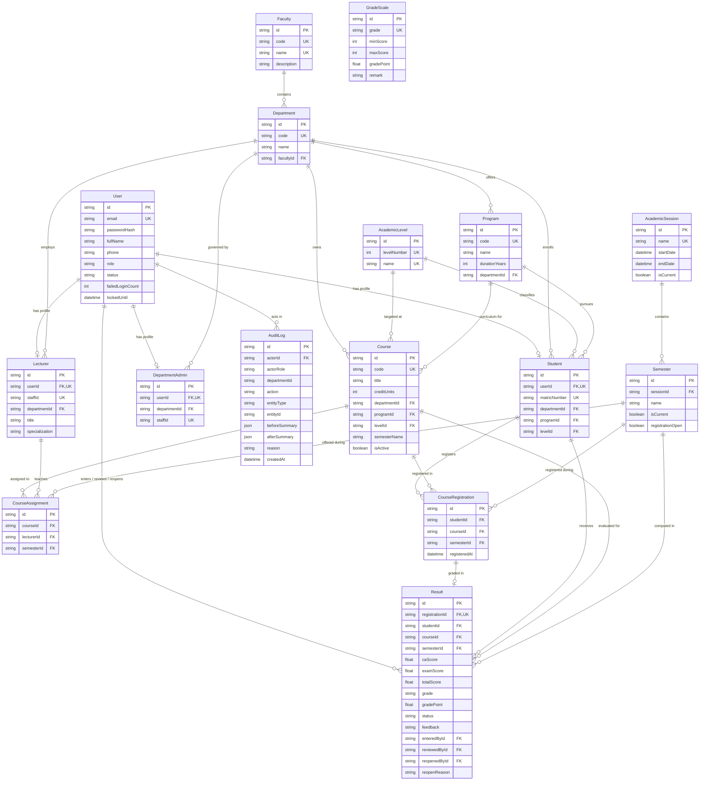

# Database Schema & Entity-Relationship (ER) Documentation

This document describes the relational database architecture powering the University Education Management Portal (UEMP). The schema consists of **16 normalized models** implemented in PostgreSQL via Prisma ORM (`prisma/schema.prisma`).

> [!NOTE]
> **Schema Verification Statement**: The Mermaid entity-relationship diagram and table dictionary below have been cross-checked directly against `prisma/schema.prisma` and validated with `npx prisma validate`. All relations, foreign keys, unique constraints, and indexes reflect the live PostgreSQL database.

---

## 1. Mermaid Entity-Relationship Diagram

---

## 2. Comprehensive Database Dictionary (16 Models)

### 1. `User`
- **Purpose**: Central authentication and identity record for all system users across all four roles.
- **Key Columns**: `id` (PK, cuid), `email` (unique), `passwordHash` (bcrypt), `fullName`, `phone`, `role` (enum: `STUDENT`, `LECTURER`, `DEPARTMENT_ADMIN`, `SUPER_ADMIN`), `status` (enum: `ACTIVE`, `SUSPENDED`, `DEACTIVATED`), `failedLoginCount`, `lockedUntil`.
- **Constraints & Indexes**:
  - `UNIQUE (email)`: Prevents duplicate accounts.
  - `INDEX (role, status)`: Accelerates authentication and user directory filtering.
- **Business Rule Enforced**: Secures credential authentication and immediate lockout after 5 failed attempts (Section 3).

### 2. `Faculty`
- **Purpose**: Top-level academic division representing a group of related departments.
- **Key Columns**: `id` (PK, cuid), `name` (unique), `code` (unique, e.g. "SCI"), `description`.
- **Constraints & Indexes**: `UNIQUE (code)`, `UNIQUE (name)`.
- **Business Rule Enforced**: Institutional hierarchy and organizational structure (Section 6.7).

### 3. `Department`
- **Purpose**: Academic division offering degree programs, courses, and housing academic staff and students.
- **Key Columns**: `id` (PK, cuid), `name`, `code` (unique, e.g. "CSC"), `facultyId` (FK $\to$ `Faculty.id`).
- **Constraints & Indexes**:
  - `UNIQUE (code)`: Ensures unique departmental acronyms across the university.
  - `UNIQUE (facultyId, name)`: Prevents duplicate department names within the same faculty.
  - `INDEX (facultyId)`: Speeds up hierarchical faculty lookups.
- **Business Rule Enforced**: Multi-tenant departmental scoping and data isolation (Section 6.5).

### 4. `DepartmentAdmin`
- **Purpose**: Links a staff user account to a specific department with administrative authority.
- **Key Columns**: `id` (PK, cuid), `userId` (FK $\to$ `User.id`), `departmentId` (FK $\to$ `Department.id`), `staffId` (unique).
- **Constraints & Indexes**:
  - `UNIQUE (userId)`: Enforces exactly one department admin profile per user.
  - `UNIQUE (staffId)`: Enforces globally unique staff identification numbers.
  - `INDEX (departmentId)`: Enables fast departmental administrator lookups.
- **Business Rule Enforced**: Restricts administrative approval rights strictly to the user's assigned department (Section 6.5).

### 5. `Program`
- **Purpose**: Academic degree program (e.g. B.Sc. Computer Science).
- **Key Columns**: `id` (PK, cuid), `name`, `code` (unique, e.g. "BSC-CSC"), `durationYears` (default 4), `departmentId` (FK $\to$ `Department.id`).
- **Constraints & Indexes**:
  - `UNIQUE (code)`: Enforces unique program codes university-wide.
  - `UNIQUE (departmentId, name)`: Prevents duplicate programs within the same department.
  - `INDEX (departmentId)`: Speeds up program queries by department.
- **Business Rule Enforced**: Curricular eligibility mapping for student admissions and course selections (Section 6.1).

### 6. `AcademicLevel`
- **Purpose**: Represents undergraduate student year/level classification (100L–500L).
- **Key Columns**: `id` (PK, cuid), `levelNumber` (unique integer: 100, 200, 300, 400, 500), `name` (unique string: "100 Level").
- **Constraints & Indexes**: `UNIQUE (levelNumber)`, `UNIQUE (name)`.
- **Business Rule Enforced**: Enforces course registration eligibility strictly matching the student's current academic level (Section 6.1).

### 7. `AcademicSession`
- **Purpose**: Represents an entire academic year (e.g. "2026/2027").
- **Key Columns**: `id` (PK, cuid), `name` (unique), `startDate`, `endDate`, `isCurrent` (boolean).
- **Constraints & Indexes**: `UNIQUE (name)`.
- **Business Rule Enforced**: Academic temporal scoping; historical transcript grouping (Section 6.7).

### 8. `Semester`
- **Purpose**: A term within an academic session (FIRST or SECOND semester).
- **Key Columns**: `id` (PK, cuid), `sessionId` (FK $\to$ `AcademicSession.id`), `name` (enum: `FIRST`, `SECOND`), `isCurrent` (boolean), `registrationOpen` (boolean).
- **Constraints & Indexes**:
  - `UNIQUE (sessionId, name)`: Guarantees exactly one First and one Second semester per academic session.
  - `INDEX (isCurrent)`: Speeds up resolution of the currently active semester for course registration and grading.
- **Business Rule Enforced**: Gates course registration and grade submission to open, active semesters only (Section 6.1).

### 9. `Student`
- **Purpose**: Profile attributes and academic placement for a student user.
- **Key Columns**: `id` (PK, cuid), `userId` (FK $\to$ `User.id`), `matricNumber` (unique), `departmentId` (FK), `programId` (FK), `levelId` (FK), `gender`, `dateOfBirth`, `address`.
- **Constraints & Indexes**:
  - `UNIQUE (userId)`: 1:1 profile link to `User`.
  - `UNIQUE (matricNumber)`: Ensures university-wide uniqueness of student matriculation numbers.
  - `INDEX (departmentId, programId, levelId)`: Accelerates cohort filtering and registration validation.
- **Business Rule Enforced**: Prevents matriculation duplication and binds students to department, program, and level constraints (Section 6.1).

### 10. `Lecturer`
- **Purpose**: Profile details and departmental affiliation for academic staff.
- **Key Columns**: `id` (PK, cuid), `userId` (FK $\to$ `User.id`), `staffId` (unique), `departmentId` (FK $\to$ `Department.id`), `title`, `specialization`.
- **Constraints & Indexes**:
  - `UNIQUE (userId)`: 1:1 link to `User`.
  - `UNIQUE (staffId)`: Unique staff identifier.
  - `INDEX (departmentId)`: Enables scoped lecturer directories.
- **Business Rule Enforced**: Departmental staff binding and qualification for course assignment (Section 6.3).

### 11. `Course`
- **Purpose**: Catalog of academic courses offered by departments.
- **Key Columns**: `id` (PK, cuid), `code` (unique, e.g. "CSC 301"), `title`, `creditUnits` (1–6), `description`, `departmentId` (FK), `programId` (FK), `levelId` (FK), `semesterName` (enum), `isActive` (boolean).
- **Constraints & Indexes**:
  - `UNIQUE (code)`: Enforces unique course codes.
  - `INDEX (departmentId, programId, levelId, semesterName)`: Fast matching of eligible courses for a registering student.
- **Business Rule Enforced**: Course eligibility checking based on program, level, and semester matching (Section 6.1).

### 12. `CourseAssignment`
- **Purpose**: Formal allocation of an academic course to a lecturer for a specific semester.
- **Key Columns**: `id` (PK, cuid), `courseId` (FK $\to$ `Course.id`), `lecturerId` (FK $\to$ `Lecturer.id`), `semesterId` (FK $\to$ `Semester.id`).
- **Constraints & Indexes**:
  - `UNIQUE (courseId, lecturerId, semesterId)`: Prevents assigning the same lecturer to a course twice in the same semester.
  - `INDEX (courseId, semesterId)`: Backs Decision D12 ensuring single-lecturer allocation per course/semester.
  - `INDEX (lecturerId, semesterId)`: Fast retrieval of a lecturer's assigned score sheets.
- **Business Rule Enforced**: Restricts result entry exclusively to the assigned lecturer (Section 6.3).

### 13. `CourseRegistration`
- **Purpose**: Records a student's enrollment in a course for an academic semester.
- **Key Columns**: `id` (PK, cuid), `studentId` (FK), `courseId` (FK), `semesterId` (FK), `registeredAt`.
- **Constraints & Indexes**:
  - `UNIQUE (studentId, courseId, semesterId)`: **Crucial Rule**: Prevents a student from registering for the same course twice within the same semester.
  - `INDEX (courseId, semesterId)`: Fast roster retrieval for lecturer score sheets.
  - `INDEX (studentId, semesterId)`: Quick loading of a student's semester registration slip.
- **Business Rule Enforced**: Duplicate registration prevention at the database level (Section 6.2).

### 14. `Result`
- **Purpose**: Continuous assessment, exam scores, computed totals, letter grades, and workflow status for a registered course.
- **Key Columns**: `id` (PK, cuid), `registrationId` (FK, unique), `studentId` (FK), `courseId` (FK), `semesterId` (FK), `caScore` (0–30), `examScore` (0–70), `totalScore` (0–100), `grade` (A–F), `gradePoint` (0.0–5.0), `status` (enum: `DRAFT`, `SUBMITTED`, `APPROVED`, `RETURNED`), `feedback`, `enteredById` (FK), `reviewedById` (FK), `reopenedById` (FK), `reopenReason`.
- **Constraints & Indexes**:
  - `UNIQUE (registrationId)`: Guarantees exactly one result record per course registration.
  - `UNIQUE (studentId, courseId, semesterId)`: Prevents multiple result records for the same student, course, and semester.
  - `INDEX (courseId, semesterId, status)`: Powers departmental approval inboxes and lecturer submission tracking.
  - `INDEX (studentId, status)`: Accelerates student GPA/CGPA queries (filtering strictly for `APPROVED`).
- **Business Rule Enforced**: Strict multi-stage review workflow, approval gating, and visibility limitation to approved records only (Section 6.4, 6.5, 6.6).

### 15. `GradeScale`
- **Purpose**: Configurable grading thresholds, letter grades, and quality points.
- **Key Columns**: `id` (PK, cuid), `grade` (unique, e.g. "A"), `minScore` (e.g. 70), `maxScore` (e.g. 100), `gradePoint` (e.g. 5.0), `remark` (e.g. "Excellent").
- **Constraints & Indexes**:
  - `UNIQUE (grade)`: Ensures distinct letter grade keys.
  - `UNIQUE (minScore, maxScore)`: Prevents overlapping or duplicate score ranges.
- **Business Rule Enforced**: Configurable institutional grading scale and weighted GPA computation (Section 6).

### 16. `AuditLog`
- **Purpose**: Immutable, append-only historical log of all security and workflow events.
- **Key Columns**: `id` (PK, cuid), `actorId` (FK $\to$ `User.id`), `actorRole` (enum), `departmentId` (nullable string), `action` (enum), `entityType`, `entityId`, `beforeSummary` (json), `afterSummary` (json), `reason`, `createdAt`.
- **Constraints & Indexes**:
  - `INDEX (departmentId)`: Enables scoped audit log queries for Department Admins.
  - `INDEX (entityType, entityId)`: Enables entity-specific audit history inspection.
  - `INDEX (actorId, createdAt)`: Enables tracking of user activity timelines.
  - `INDEX (action, createdAt)`: Enables system-wide compliance monitoring.
- **Business Rule Enforced**: Complete traceability of all result modifications, approvals, and administrative mutations (Section 6.8).
